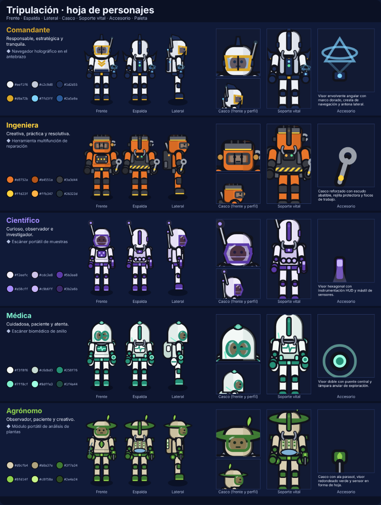
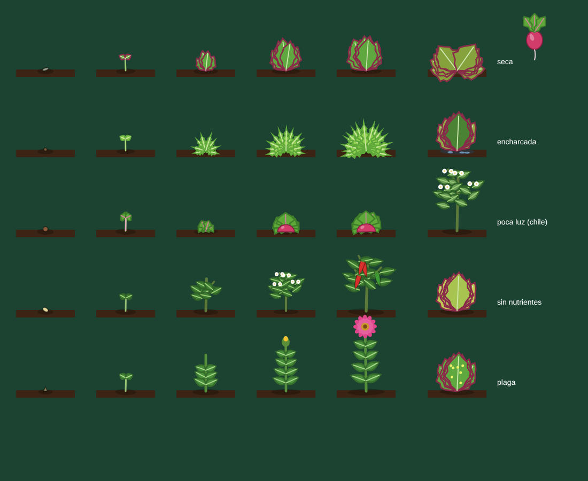

# Junior Astronaut Mission Trainer

Simulador educativo 2D (vista cenital) para niños y niñas de 7 a 12 años. El jugador administra un puesto avanzado en la **Luna** (región del cráter Shackleton) o en **Marte** (Jezero, Arcadia Planitia, Valles Marineris y Gale como escenarios de comparación). Aprende que cada recurso es limitado, que toda decisión tiene consecuencias y que la ingeniería espacial también se relaciona con retos de **República Dominicana** y del planeta.

- Un solo archivo jugable: `index.html` (HTML5 + Canvas 2D + CSS3 + JavaScript puro + Web Audio API + localStorage).
- Sin bibliotecas, motores, frameworks ni servidores. Funciona sin Internet.
- Español por defecto, inglés opcional.

## Jugar en línea
- **GitHub Pages:** https://socra375.github.io/Astro-Caribe-Challenge/ (se publica automáticamente con cada cambio en `main`; requiere activar Pages una vez en *Settings → Pages → Source: GitHub Actions*).
- También funciona sin Internet: descarga `index.html` y ábrelo con doble clic.

## Cómo ejecutar

1. Descarga o clona el repositorio.
2. Abre `index.html` con doble clic en Chrome, Edge o Firefox.

No hace falta instalar nada. Si el navegador bloquea `localStorage` (modo privado estricto o `file://` restringido), el juego avisa y usa una sesión temporal.

## Controles

| Acción | Ordenador | Táctil |
|---|---|---|
| Moverse | WASD o flechas | Joystick virtual (abajo a la izquierda) |
| Interactuar | E, Enter o Espacio | Botón grande **E** o botón de interacción |
| Pausa | P o botón ❚❚ | Botón ❚❚ |
| Silenciar | M o botón 🔊 | Botón 🔊 |
| Cerrar panel | Esc | ✕ |
| Velocidad del tiempo | botón x1 / x2 / x4 | igual |

Los minijuegos tienen controles de teclado y de puntero o táctiles (se explican en cada pantalla de instrucciones).

## Dos modalidades en un mismo juego
Al empezar se elige una modalidad, que se guarda con la partida. Comparten mapa, personajes, instalaciones, misiones, motor de simulación y base científica; cambian la profundidad, el lenguaje, la interfaz y algunas mecánicas.

| | Explorador Junior (7 a 12 años) | Ingeniero de Misión (13 años en adelante) |
|---|---|---|
| Indicadores | 4 simples: aire, agua, energía y comida (barra + «Bien / Cuidado / ¡Urgente!»), sin unidades | 5 detallados: soporte vital (O₂ y H₂O), energía, radiación, alimentos y bienestar, con valores, unidades y tendencia (↑ ↓ →) |
| Lenguaje | Palabras cotidianas, una idea por frase, ejemplos sencillos | Terminología técnica, nombres de sistemas, unidades y relaciones entre variables |
| Fallos | Menos tipos (sin sensores descalibrados ni fallo térmico) y presentados de forma progresiva: día 1 averías simples, día 2 plagas, día 3 comunicaciones y presión, día 4 tormentas solares | Todos los fallos desde el principio y **encadenados**: el polvo desgasta los paneles, una tormenta solar puede cortar el enlace y la falta de agua sin reparar daña las plantas |
| Reparar | Minijuego sencillo con más tiempo (×1,4) | **Diagnóstico previo**: hay que elegir la causa a partir de la telemetría; acertar desbloquea la reparación y la adelanta un 20 %, fallar cuesta 1 h |
| Energía | Reparto automático por prioridades | Prioridades de reparto configurables para laboratorio, rover, extractor, obras, luces y bombas |
| Comunicaciones | Retraso reducido (40 %) para que sea ágil, explicado en pantalla | Retraso completo (escala 1 min-luz ≈ 1 h) y respuestas con datos antiguos |
| Decisiones | «¿Qué pasará?»: qué mejora y qué se gasta en palabras (un poco / bastante / mucho) | Panel de consecuencias numérico: ahora, 12 h sin actuar y 12 h con la decisión, con unidades |
| Recursos | Tarjetas con barra y una frase | Tabla con producción, consumo y umbrales, gráficos de tendencia y tabla de datos clasificados (real / histórico / modelo / jugabilidad) con su fuente |
| NPC y alertas | Orientación paso a paso con ejemplos | Valores en vivo del sistema (eficiencia, kW, kPa…) y diagnóstico |
| Preguntas | Cortas, con botones grandes e icono (causa-efecto) | De razonamiento con cálculos, interpretación de datos y justificación |
| Ayudas | Pistas y flecha activadas | Desactivadas por defecto, y el ingeniero repara de forma autónoma más despacio y solo tras el diagnóstico |
| Dificultad | Fija y guiada | «Estándar» o «Exigente» |

La modalidad avanzada añade sistemas (diagnóstico, cadenas, prioridades, datos), no solo menos recursos. Los dos niveles explican el mismo fenómeno: el texto técnico es la versión avanzada del mismo contenido. Las pruebas comprueban que ambas completan la campaña, que Junior no usa jerga y que Ingeniero no es infantil.

## Características

### Interfaz limpia
Sin emojis decorativos: el juego usa iconografía propia en SVG (módulo `Icons`, también para el canvas). Las explicaciones largas están en paneles plegables «Más información». Los avisos repetidos se fusionan, y los gráficos solo aparecen en el modo Ingeniero.

### Mapa y exploración
- Mapa original de 60 × 56 baldosas con 7 instalaciones conectadas en anillo por pasillos: Puente de mando, Módulo de vida, Invernadero, Reactor y energía, Reciclaje de agua y oxígeno, Protección radiológica y bahía del rover, Laboratorio científico.
- Puertas automáticas animadas, esclusa con enclavamiento (nunca abre las dos puertas a la vez) y una superficie exterior con muestras para recoger.
- Colisiones con paredes y mobiliario, cámara que sigue al jugador, minimapa, indicador de interacción por proximidad y flecha guía hacia el objetivo actual.
- La distribución (salas, pasillos, consolas, puertas) está inspirada en el **género** de exploración cenital. No se reproducen mapas, personajes, logotipos ni recursos de ningún juego existente. No hay impostores, votaciones ni eliminaciones.

### Tripulación (bots)
El jugador es el comandante. Cuatro bots con especialidades y efectos reales en el modelo:

| Especialidad | Efecto en la simulación |
|---|---|
| Ingeniera | Repara incidentes de forma autónoma y lenta; las obras avanzan un 30 % más rápido |
| Científico | Análisis de muestras un 50 % más rápido |
| Médica | +6 puntos al objetivo de moral |
| Agrónomo | Cultivos un 15 % más rápidos |

Durante una tormenta solar, si el protocolo de refugio está activo, los bots caminan al refugio y **pierden temporalmente sus bonus**: es una compensación real del modelo.

### Diseño de personajes


Los cinco astronautas son originales y están dibujados por código (módulo `Chars`, archivo `src/04b_chars.js`) con trazados, polígonos y curvas por capas. No hay imágenes externas ni spritesheets. Proporción de unas 3,5 cabezas, casco separado del torso por un anillo de cuello, hombros, brazos con codo articulado y guantes, cinturón técnico, piernas separadas con rodilleras y botas voluminosas. Cada especialidad se reconoce **por la silueta**, no solo por el color:

| Personaje | Casco | Soporte vital | Rasgo de silueta | Accesorio |
|---|---|---|---|---|
| Comandante (jugador) | Visor envolvente angular con marco dorado, cresta de navegación, antena | Dos depósitos, regulador central, panel de diagnóstico | Hombreras con alerón | Navegador holográfico en el antebrazo |
| Ingeniera | Escudo abatible, rejilla y focos de trabajo; visor de rendija segmentado | Bastidor de carga con llave integrada y franjas de seguridad | Más ancha, blindaje en hombros y rodillas, cinturón de herramientas | Herramienta multifunción |
| Científico | Visor hexagonal con HUD, mástil de sensores | Mochila ligera con carrusel de cápsulas de muestras | Más esbelto, mástil alto | Escáner de muestras con haz |
| Médica | Cúpula con visor doble y lámpara anular | Mochila redondeada con módulo de primeros auxilios | Cúpula, mochila redonda que asoma, bolsas en las caderas | Escáner biomédico de anillo y banda biométrica |
| Agrónomo | Ala parasol, visor redondeado, sensor en forma de hoja | Tubos de semillas, depósito de riego y manguera al guante | Ala ancha, bolsas de semillas | Módulo de análisis de plantas |

- **Vistas:** frente, espalda, perfil derecho y perfil izquierdo (espejado), coherentes con la vista cenital del mapa. El rostro se ve parcialmente tras el visor (con expresiones: neutral, concentración, alerta y alegría).
- **Animaciones:** reposo (respiración), caminar (brazos y piernas independientes, rodillas que se doblan), interactuar, reparar (con chispas), transportar (caja de muestras), alerta (con «!») y celebrar. Con «reducir animaciones», los saltos y vaivenes se eliminan y el balanceo de extremidades se reduce a la mitad.
- **Pivote y tamaño:** pies en (0,0), altura ≈ 64 unidades; en el juego se dibujan a escala 0,82 (≈1,6 baldosas). La colisión sigue siendo el círculo pequeño de los pies, así que el movimiento, las puertas y los controles no cambian. En pantallas estrechas la cámara se acerca (≈11 baldosas de ancho) para que los personajes sigan siendo legibles.
- **Cuándo se usa cada pose:** el jugador interactúa mientras hay un panel abierto, repara durante el minijuego de cableado, transporta tras recoger una muestra, se alerta si hay una alerta crítica y celebra al completar una misión. Los bots reparan, interactúan en su sala, transportan muestras o plantas al desplazarse, se alertan en el refugio y celebran con el equipo.
- **Hoja de presentación:** `index.html?sheet` o «Manual → Hoja de personajes». Muestra las tres vistas, ampliaciones de casco, soporte vital y accesorio, paleta y las 7 animaciones en vivo, todo con el mismo código que se usa en el juego.
- Los emblemas son originales. La médica usa una pantalla de pulso, no una cruz roja (emblema protegido).

### Familiarización, NPC guía y desbloqueo de secciones
Al empezar solo están abiertas tres secciones: **Puente de mando, Módulo de vida y Reactor y energía**. Las demás tienen las puertas cerradas (en rojo y con 🔒 en el mapa y el minimapa); al acercarse, el juego explica qué misión las abre. Cada sección se desbloquea **al cumplir objetivos reales**, no al pulsar un botón:

| Misión de familiarización | Objetivos (detectados por el motor) | Desbloquea · guía |
|---|---|---|
| 1. Activación de la colonia | Escuchar al guía, revisar Recursos, visitar el módulo de vida y la enfermería, visitar el reactor y **ajustar la energía** (reactor, modo emergencia o minijuego solar/balance) | Agua y oxígeno · Sofía |
| 2. Recuperación del ciclo de agua | **Reparar** la bomba averiada, **calibrar** el oxígeno y **mantener** reciclaje ≥ 78 % y agua ≥ 30 % durante 6 h | Invernadero · Teo |
| 3. Primer cultivo | **Sembrar** 3 semillas, **regar**, **añadir nutrientes** y **cosechar** una planta madura | Laboratorio · Leo |
| 4. Exploración científica | **Analizar** una muestra, usar el espectrómetro y consultar el registro | Protección radiológica y bahía del rover · Ana |

- Al entrar por primera vez en una sección, su guía mantiene una **conversación corta de 5 pasos**: se presenta, explica para qué sirve la sección, sus sistemas, la misión y cómo usar la consola. No se repite; se puede volver a escuchar en «Pausa → Conversaciones».
- Guías: Control de Misión (puente, mientras el jugador es el comandante), Sofía (médica: vida y agua/O₂), Ana (ingeniera: reactor y bahía del rover), Teo (agrónomo: invernadero) y Leo (científico: laboratorio). No hay un sexto personaje «de exploración»: la bahía del rover la presenta Ana, que opera el rover según la tabla de permisos.
- Las **siete misiones avanzadas** se activan al terminar la familiarización. Antes de eso, los eventos aleatorios solo ocurren en secciones abiertas y con la mitad de frecuencia.

### Vestuario y especialistas
En el puente hay un **vestuario** 🧥. El jugador elige especialista y cambian el sprite, el traje, las animaciones, la especialidad y las acciones disponibles. El especialista anterior aparece como NPC junto al vestuario y el elegido deja de estar en el mapa (el jugador ocupa su puesto).

| Sección | Especialista |
|---|---|
| Puente de mando (misiones, comunicaciones) | Comandante |
| Módulo de vida (enfermería) | Médica |
| Reactor y energía | Ingeniera |
| Agua y oxígeno | Ingeniera o médica |
| Invernadero y plantas | Agrónomo |
| Laboratorio | Científico |
| Blindaje y refugio | Científico o ingeniera |
| Rover y extractor de hielo | Ingeniera |

- Los permisos solo se aplican **después** de la familiarización. Pasillos, cabinas, sala de bienestar, Conexión con la Tierra, esclusa y muestras exteriores son de uso común.
- Sin el traje adecuado, el juego explica quién puede hacerlo y marca el vestuario. **Las emergencias nunca se bloquean**: cualquiera puede hacer una «reparación de emergencia» de los incidentes de esa sala o activar el protocolo de refugio durante una tormenta. Los indicadores del HUD siempre abren los recursos.
- Ventajas al llevar cada traje: la ingeniera repara mejor (+15 % en el minijuego de cableado), el agrónomo gasta menos nutrientes, el científico analiza más rápido (2 h en lugar de 3) y la médica opera la enfermería.

### Llamadas de radio de los NPC
Las averías, eventos ambientales y umbrales de recursos generan una **llamada interna** en la parte inferior de la pantalla, sin mover a nadie por el mapa. Cada llamada incluye retrato, nombre, especialidad, tipo de alerta, descripción, ubicación exacta (por ejemplo, las jardineras con plaga), qué hacer y qué pasa si se ignora. Botones: **Entendido**, **Marcar ubicación** (marcador en el minimapa y flecha en pantalla), **Consultar sistema** (abre el panel de la instalación) y **Ver explicación** (panel «¿Por qué ocurrió?»).

| Tema | Quién llama |
|---|---|
| Oxígeno, presión, sensor de O₂, bienestar | Médica |
| Agua (reciclador) | Ingeniera; reservas de agua: médica |
| Energía, reactor, paneles, temperatura, desgaste | Ingeniera |
| Cultivos y alimentos | Agrónomo |
| Radiación, dosis, análisis | Científico |
| Comunicaciones y objetivos generales | Comandante |

Cola con prioridad (crítica > advertencia > información). Las críticas se quedan hasta pulsar «Entendido»; las advertencias desaparecen a los 18 s y la información a los 9 s. Una llamada interrumpida por otra más urgente vuelve a la cola, y los mensajes idénticos se fusionan en lugar de repetirse.

### Invernadero interactivo


- **Cinco especies cultivadas realmente en la ISS** (sistemas Veggie y Advanced Plant Habitat de NASA), dibujadas por código con silueta propia: lechuga romana roja (roseta erguida de hojas onduladas), mizuna (mata ancha de hojas finas y dentadas), rábano (hojas lobuladas y raíz roja que asoma al madurar), chile (planta ramificada con hojas en punta, flores y frutos) y zinnia (tallo con hojas opuestas, botón y flor).
- **Cinco etapas:** semilla, brote (cotiledones con forma propia, como los acorazonados del rábano), planta joven, desarrollo avanzado y planta madura. Cada planta tiene variaciones naturales (tamaño, inclinación, número de hojas, color de la flor) para que no haya clones.
- **Estado visible:** marchitez y tono pardo si falta agua, charcos y hojas viejas amarillas si sobra, tallo largo y pálido con poca luz, clorosis sin nutrientes y pequeños insectos si hay plaga.
- **Jardineras:** sustrato, tubo de riego con goteros, sensor de humedad con piloto de color, barra LED que brilla según la potencia, etiqueta de especie e indicador de crecimiento por planta.
- **18 plantas independientes** (6 jardineras × 3). Pulsa E junto a una planta o tócala para abrir su ficha: especie, etapa, tiempo de cultivo, salud, humedad, nutrientes, iluminación, temperatura y progreso, con orientación de Teo y un dato real de la ISS.
- **Acciones con coste real:** sembrar (1 semilla, 0,5 L de agua y 0,2 L de nutrientes), regar (0,3 L), añadir nutrientes (0,3 L de solución, o 0,22 L si eres el agrónomo), luz LED de la jardinera (0,6 kW al 100 %, compite con los demás sistemas por la energía), inspeccionar, identificar problemas (las plagas no se ven del todo hasta identificarlas), podar (cuando hay exceso de ramas, plaga identificada o daño) y cosechar (suma alimentos; devuelve semillas y residuos orgánicos). La zinnia no es comestible y sube la moral.
- **Modelo:** el crecimiento depende de la luz frente a la necesidad de la especie, de la humedad (ideal 35–75 %), de los nutrientes, de la temperatura óptima, de la salud y del bonus del agrónomo. La sequía, el encharcamiento, la falta de luz o de nutrientes, las plagas y la temperatura dañan la salud; a 0 la planta muere. El riego automático con sensores repone hasta el 65 % (el goteo ahorra un 45 % de agua) y la solución nutritiva se fabrica con residuos orgánicos (economía circular).
- El **ciclo de 7 días** es una simplificación de jugabilidad, no la duración biológica real de cada cultivo; el juego lo indica en la ficha de cada planta.

### Simulación de recursos (el núcleo)
Motor `Sim` independiente de la interfaz (estado JSON puro, RNG con semilla, tiempo en horas simuladas). Cinco indicadores principales:

1. **Soporte vital**: oxígeno (kg), agua (L), concentración de O₂ en cabina, reciclaje, presión y temperatura.
2. **Energía**: paneles solares (alineación, polvo, ciclo día/noche en Marte), reactor (potencia y desgaste), batería, demanda y reparto por prioridades.
3. **Protección contra radiación**: efectividad del blindaje, dosis estimada por tripulante, plazas del refugio y eventos solares.
4. **Alimentos**: reservas, 18 plantas individuales en 6 jardineras, semillas, solución nutritiva, luz LED, riego, temperatura y crecimiento.
5. **Bienestar**: moral y descanso, que dependen de las condiciones de habitabilidad y de las alertas.

Cada recurso tiene valor, máximo, consumo por hora, producción por hora, umbral de advertencia y umbral crítico. Todo se mantiene dentro de límites válidos en una única función `normalize()`.

**Cadenas de efectos** (ejemplos reales del modelo):
- Más luz en el invernadero → más crecimiento → más consumo eléctrico → menos batería para otros sistemas.
- El oxígeno se fabrica por electrólisis: consume **agua** (1,125 L por kg de O₂) y **electricidad**.
- Reforzar el blindaje consume **materiales**, **energía** durante 6 h y **tiempo**.
- Los residuos se reciclan en materiales (economía circular), que sirven para el blindaje y el mantenimiento.
- El extractor de hielo (ISRU) produce agua a cambio de electricidad.

**Reparto eléctrico por prioridades**: 1) soporte vital, 2) comunicaciones y blindaje, 3) laboratorio, rover, obras y extractor de hielo, 4) luces y bombas del invernadero. Si falta energía se recorta primero la prioridad 4.

### Panel de consecuencias
Antes de cada decisión importante, el juego **clona el estado**, simula 12 horas con y sin la decisión (sin eventos aleatorios) y muestra: estado actual, recurso que se usará, qué aumenta, qué disminuye, riesgos y beneficios. Así la vista previa coincide con el modelo y no es un texto inventado.

### Siete misiones
1. Estabilizar el soporte vital.
2. Recuperar el suministro eléctrico.
3. Prepararse ante un evento solar (inspirado en registros reales de DONKI).
4. Seleccionar un sitio de exploración (comparación de pendiente, iluminación, geografía y riesgo).
5. Calibrar la protección radiológica (con RadLab como referencia de la ISS, claramente diferenciada).
6. Cultivar alimentos (ciclo de 7 días simulados; puede correr en paralelo con otra misión).
7. Explorar con el rover, con una falla de comunicaciones con la Tierra.

Cada misión tiene dos variantes de objetivo elegidas por la semilla, pasos, límite de tiempo cuando corresponde, estrellas (1–3), recompensas y una ficha de Conexión con la Tierra con pregunta de comprensión. Las misiones fallidas se pueden repetir con condiciones distintas.

### Comunicaciones con retraso
- Luna: ≈1,3 s de retraso real de la luz. Marte: entre ~3 y ~22 minutos según las posiciones orbitales (cada partida elige un valor en ese rango).
- **Escala del juego (simplificación G):** 1 minuto-luz ≈ 1 hora simulada, para que el retraso se note. La Luna usa un mínimo jugable de 0,3 h.
- Se muestra el mensaje enviado, el tiempo estimado, la respuesta pendiente y el mensaje recibido. La Tierra responde con **datos antiguos** (los de cuando envió el mensaje), lo que enseña a usar protocolos autónomos.
- La ruta segura pedida a la Tierra revela todos los peligros en el minijuego del rover; sin ella se conduce solo con sensores (autonomía).

### Seis minijuegos (30–60 s, 3 niveles, modo práctica)
Cableado eléctrico · Balance energético · Calibración de oxígeno · Orientación de paneles solares · Navegación del rover · Gestión del invernadero.
Cada uno tiene instrucciones, condiciones de éxito y error, resultado, explicación científica y **modifica la simulación** (salvo en modo práctica).

### Eventos y alertas
Tormenta solar, caída de generación (sombras del terreno lunar), tormenta de polvo (Marte), falla del reciclaje, fuga de presión, problema de comunicaciones, falla de cultivos, problema de temperatura, deterioro de equipos y sensor de O₂ descalibrado. Tres niveles: crítico (rojo, ⛔), advertencia (ámbar, ⚠) e información (azul, ℹ); los iconos evitan depender solo del color. Cada evento tiene un panel **«¿Por qué ocurrió?»** con: qué sucedió, sistema afectado, causa, qué hacer, dato científico y fuente con fecha. Los incidentes sin reparar escalan de gravedad.

### Victoria y finales no violentos
Se gana al completar las 7 misiones con los sistemas operativos y sin alertas críticas activas. Si se agota un recurso esencial, se supera el límite de dosis del modelo o un incidente crítico queda sin resolver, la misión termina con **evacuación preventiva** o **intervención de emergencia**: la tripulación siempre vuelve sana. Después aparece el informe final con cuatro apartados (resultado, recursos, aprendizaje, impacto en la Tierra).

### Accesibilidad y diseño adaptable
Ordenador, tablet y móvil (joystick virtual y botones grandes). Pausa, volumen, silencio, reducir animaciones (respeta `prefers-reduced-motion`), ayudas en pantalla, tres tamaños de texto, foco visible y navegación por teclado en los paneles. Contraste WCAG AA comprobado por script (`tests/contrast.js`).

## Datos científicos y fuentes

El juego distingue tres tipos de números (también en la pantalla «Fuentes científicas»):

- **R — Dato real** medido o publicado.
- **M — Estimación** derivada de un modelo.
- **G — Simplificación** para jugabilidad.

| Parámetro | Valor | Tipo | Fuente / nota |
|---|---|---|---|
| Consumo de O₂ por persona | 0,84 kg/día | R | Valor de diseño de soporte vital de NASA |
| Agua para electrólisis | 1,125 L por kg de O₂ | R | Estequiometría 2 H₂O → 2 H₂ + O₂ |
| Banda segura de O₂ en cabina | 19,5 % – 23,5 % | R | Normas de seguridad ocupacional (OSHA 29 CFR 1910.146) |
| Dosis de fondo en Marte | ≈0,64 mSv/día | R | MSL/RAD, cráter Gale (Hassler et al., *Science*, 2014) |
| Dosis de fondo en la Luna | ≈1,37 mSv/día | R | Chang'e-4 LND, cara oculta (Zhang et al., *Science Advances*, 2020) |
| Irradiancia solar en Marte | ≈43 % de la terrestre | R | NASA Mars Fact Sheet |
| Duración del sol marciano | 24,66 h | R | NASA |
| Gravedad Luna / Marte | 1,62 / 3,71 m/s² | R | NASA |
| Retraso de la luz Tierra–Marte | ~3 a ~22 min | R | NASA |
| Recuperación de agua de la ISS | >90 %, 98 % en 2023 | R | NASA (2023) |
| Eficiencia del reciclador | 0,85 (eco) / 0,93 (máx.) | M | Inferior al mejor valor de la ISS |
| Ración diaria | 0,62 kg/persona | M | Orden de magnitud de menús deshidratados |
| Agua de uso por persona | 3,5 L/día | G | Mínimo del modelo |
| Reactor | 6 kW (Luna), 10 kW (Marte) | G | Reducido; NASA estudia sistemas de fisión de ~40 kWe |
| Paneles | 12 kW (Luna), 18 kW (Marte) pico | G | Mayor superficie en Marte por la menor irradiancia y el polvo |
| Ciclo de cultivo | 7 días simulados | G | Compresión educativa (base: material de la CSA) |
| Retraso de mensajes en juego | 1 min-luz ≈ 1 h simulada | G | Para que el retraso sea perceptible |
| Tormenta solar | 2,0–2,8 mSv/h sin blindaje, 14–22 h | G | Modelo simplificado, no es una medición |
| Límite de dosis de la partida | 120 / 80 / 60 mSv | G | Umbral del juego por dificultad, no es un límite médico |
| Tiempo | 1 s real = 0,4 h simuladas (x1) | G | Un día ≈ 1 minuto |

### Fuentes oficiales consideradas
- NASA Open APIs — https://api.nasa.gov/
- DONKI (NASA CCMC) — https://ccmc.gsfc.nasa.gov/tools/DONKI/
- NASA OSDR — https://osdr.nasa.gov/bio/repo/
- RadLab — https://visualization.osdr.nasa.gov/radlab/gui/data-api/
- NASA Mars Trek — https://trek.nasa.gov/mars/ · Moon Trek — https://trek.nasa.gov/moon/
- Agencia Espacial Canadiense, producción de alimentos — https://www.asc-csa.gc.ca/eng/youth-educators/toolkits/food-production/
- Oficina Nacional de Estadística — https://www.one.gob.do/
- Ministerio de Energía y Minas — https://mem.gob.do/
- Ministerio de Medio Ambiente y Recursos Naturales — https://ambiente.gob.do/
- INDRHI, ONAMET y Ministerio de Agricultura (referencias cualitativas)

### Cómo se usa cada conjunto de datos (y sus límites)
- **DONKI**: la Misión 3 se inspira en tres registros históricos guardados localmente (erupción X17 del 2003-10-28, X9.3 del 2017-09-06 y tormenta geomagnética G5 del 2024-05-10). Un evento de DONKI **no equivale** a una dosis recibida por una persona.
- **RadLab**: se presenta como referencia de dosimetría de la **ISS**, que orbita dentro del campo magnético terrestre. **No** son mediciones de la Luna ni de Marte.
- **OSDR**: se cita como repositorio de investigación biológica, **no** como monitorización médica en tiempo real.
- **Mars Trek / Moon Trek**: los sitios de la Misión 4 llevan valoraciones **cualitativas** del juego (1–5) basadas en descripciones públicas; no son mediciones ni certifican que un lugar sea seguro.
- **CSA**: inspira el contenido de cultivo; el ciclo de 7 días es una compresión educativa.

### República Dominicana
**No se inventan estadísticas dominicanas.** Las fichas de Conexión con la Tierra usan explicaciones cualitativas (gestión del agua, energía solar y almacenamiento, invernaderos y riego por goteo, preparación ante huracanes, residuos y protección ambiental) y remiten a las instituciones oficiales. Las referencias normativas citadas son la Ley 57-07 (incentivo a energías renovables) y la Ley 225-20 (gestión integral de residuos sólidos). La temporada de huracanes del Atlántico (1 de junio a 30 de noviembre) se cita como dato general. Los "Prueba tú" interactivos usan **ejemplos ilustrativos** marcados como tales; el calculador de retraso Tierra–Marte usa física real (distancia ÷ velocidad de la luz).

Los Objetivos de Desarrollo Sostenible (2, 3, 4, 6, 7, 9, 11, 12, 13 y 17) aparecen con una frase que explica la relación concreta con la decisión de ingeniería, y cada ficha incluye un apartado de **límites para transferir la solución**.

## Integración con NASA y funcionamiento sin conexión
- Al abrir el juego, si hay conexión, se intenta una única petición a `https://api.nasa.gov/DONKI/FLR` (últimos 30 días) con `DEMO_KEY` y un tiempo máximo de 7 s. Si responde, las erupciones aparecen en «Fuentes científicas» y en el panel «¿Por qué ocurrió?» de las tormentas, con la fecha de consulta.
- Si no hay conexión, se alcanza el límite de `DEMO_KEY` o la API falla, el juego usa los registros históricos locales y lo indica («no es en tiempo real»). **La indisponibilidad de una API nunca impide jugar.**
- La última respuesta válida se guarda en `localStorage` como respaldo.

### Claves de API
- Solo se usa `DEMO_KEY`, la clave pública de pruebas de api.nasa.gov, con límites de uso bajos. **No es una clave privada** y no hay credenciales en el código.
- Para un uso intensivo (por ejemplo, un aula entera conectada a la vez), cada centro puede obtener su propia clave gratuita en https://api.nasa.gov/ y sustituir `DEMO_KEY` en la función `fetchDonki` de `index.html`. No la publiques en un repositorio público.

## Guardado
`localStorage` (clave `jamt.v1`) guarda partida en curso, ajustes, idioma, estadísticas, logros y fichas desbloqueadas. Todo acceso va dentro de `try/catch`; si está bloqueado, el juego usa memoria temporal. Autoguardado cada 15 s, al pausar y al cambiar de pestaña.

## Arquitectura de `index.html`
Un solo archivo, organizado en módulos internos con responsabilidades separadas:

| Módulo | Responsabilidad |
|---|---|
| `DATA` | Textos bilingües, misiones, eventos, fuentes, fichas, sitios y preguntas |
| `Store` | Almacenamiento seguro con respaldo en memoria |
| `Sfx` | Sonidos originales sintetizados con Web Audio API |
| `Sim` | Motor de simulación puro (entre los marcadores `/*SIM-START*/` y `/*SIM-END*/`) |
| `SelfTest` | 100 simulaciones automáticas sobre `Sim` |
| `Icons` | Iconos SVG por rutas (DOM y canvas) y conversión de pictogramas |
| `Chars` | Los cinco astronautas: dibujo por capas, 4 direcciones y 7 poses |
| `Flora` | Las cinco especies vegetales: 5 etapas, variación natural y estados de estrés |
| `NPCDATA` | Guías, conversaciones, campaña, contenido de las llamadas y fichas botánicas |
| `World` | Mapa, colisiones, puertas, esclusa, bots, cámara, render Canvas, partículas y minimapa |
| `MG` | Seis minijuegos |
| `Game` | Bucle principal, entrada, HUD, consolas, panel de consecuencias, comunicaciones, fichas, informe y menús |

Para facilitar el mantenimiento, el mismo código está dividido por módulos en `src/`. `tools/build.sh` concatena esos archivos y regenera `index.html`; edita `src/` y reconstruye en lugar de editar `index.html` a mano.

## Pruebas
Requieren Node.js; las de navegador, además, Playwright con Chromium.

```bash
node tests/run-selftest.js 100
```

```bash
node tests/contrast.js
```

```bash
node tests/e2e.js
```

**Integración continua:** `.github/workflows/pruebas.yml` ejecuta en GitHub Actions, en cada PR y en cada cambio en `main`, la comprobación de que `index.html` coincide con `src/`, las 100 simulaciones, el contraste y las pruebas e2e en Chromium. Guarda las capturas como artefacto. Un PR solo está «en verde» si pasan todas.

También puedes abrir `index.html?selftest` o usar «Configuración → Ejecutar 100 simulaciones de prueba». Las pruebas trabajan sobre copias del motor y no modifican el progreso del jugador.

**Resultados obtenidos al construir esta versión:**
- `run-selftest.js`: 100 simulaciones (Luna/Marte × 3 dificultades, 75 con una política activa y 25 pasivas), **0 errores**: sin NaN, sin valores negativos, todos los recursos y plantas dentro de sus límites y finales coherentes. La política activa completa la familiarización y gana las 75 partidas (50 en Junior y 25 en Ingeniero, con diagnóstico previo); la pasiva nunca gana (se agotan alimentos o quedan incidentes críticos sin resolver).
- `contrast.js`: 14/14 pares de tokens cumplen WCAG AA.
- `e2e.js` (Chromium, sin Internet): **113/113** comprobaciones: inicio, escenario y dificultad, movimiento, colisiones, puertas, interacción, misiones, pausa con paneles abiertos, panel de consecuencias, minijuego que repara un incidente, comunicaciones con retraso y respuesta, evento con «¿Por qué ocurrió?», guardado y recuperación, ficha y pregunta, cambio de idioma, informe final, cero errores de consola, `localStorage` bloqueado, móvil de 390 × 844 px con joystick táctil y sin desplazamiento horizontal, SelfTest en el navegador y personajes: las 140 combinaciones de personaje × dirección × pose se dibujan sin errores, las piernas aparecen separadas y las siluetas (solo la máscara de forma, sin color) difieren entre especialidades: el solapamiento máximo entre dos personajes es 0,875 de frente y 0,877 de perfil, por debajo del umbral de 0,9. Además, la familiarización completa con acciones reales: solo 3 secciones al empezar, puertas bloqueadas, cada guía presentándose al entrar, desbloqueo de cada sección al terminar su misión y las 7 abiertas al final. Modalidades: la pantalla de inicio ofrece las dos, se guardan y se recuperan con la partida, Junior muestra 4 indicadores sin unidades y Ingeniero 5 con unidades, los textos de Junior no contienen jerga técnica en español ni en inglés (frases de 190 caracteres como máximo) y los de Ingeniero conservan los términos, las explicaciones cambian de nivel manteniendo el fenómeno, Junior no recibe sensores descalibrados ni fallos térmicos, las cadenas de eventos solo ocurren en Ingeniero, el diagnóstico bloquea la reparación hasta acertar (y el error cuesta 1 h), las llamadas y las conversaciones de los NPC cambian de nivel, hay preguntas distintas por nivel, el informe se adapta, la interfaz no contiene emojis y el móvil de 390 px no tiene scroll horizontal en ninguno de los dos modos. Plantas: selección individual, sembrar gasta semillas, regar gasta agua, los nutrientes gastan solución, subir el LED aumenta la demanda eléctrica, cosechar suma alimentos, la nutrición cambia el crecimiento (0,148 frente a 0,022 en 24 h), las cinco especies tienen siluetas distintas (solapamiento máximo 0,633) y las cinco etapas crecen en tamaño. Especialistas y alertas: el vestuario cambia de rol y deja al anterior como NPC, los permisos no bloquean las reparaciones de emergencia, cada fallo lo comunica el NPC adecuado, «Marcar ubicación» coloca el marcador, los mensajes repetidos no se acumulan y las alertas críticas tienen prioridad.

**No probado:** Firefox, Edge y Safari reales, tablets o teléfonos físicos y lectores de pantalla. El código usa solo APIs estándar (Canvas 2D, Pointer Events, Web Audio, `fetch`), pero esas plataformas no se han verificado.

## Limitaciones conocidas
- El modelo es educativo y simplificado; no sirve para diseñar una base real.
- No es una PWA: no hay *service worker* ni manifiesto. Funciona sin conexión porque es un único archivo local.
- Solo se integra DONKI en vivo. OSDR, RadLab, Mars Trek y CSA se citan como referencias con enlaces y datos incorporados, porque sus interfaces no ofrecen una consulta sencilla y útil desde un archivo local sin servidor.
- Los textos en inglés son más breves que en español en algunos paneles.
- El retraso de las comunicaciones y el ciclo de cultivo están comprimidos en el tiempo (documentado arriba).
- Con `file://`, algunos navegadores restringen `localStorage`; en ese caso el progreso dura solo la sesión.

## Licencia y créditos
Código, gráficos (dibujados por código) y sonidos (sintetizados) son originales de este proyecto. Los nombres de misiones y agencias se citan con fines educativos.
